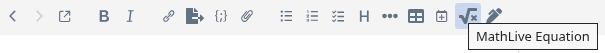
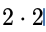
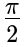
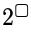
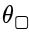
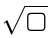
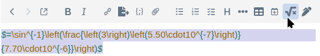

# MathLive Joplin Plugin

Edit math equations, formulas and LaTeX/KaTeX expressions visually with MathLive — no need to learn LaTeX syntax.

To insert an equation, use the menu item or the default shortcut: *Ctrl+Alt+M*

## How to use the editor
The MathLive editor can be used entirely on a touchscreen or entirely by keyboard, making it both easier and faster than manually typing LaTeX.

### Keyboard shortcuts

To type quickly, you can optionally learn these to avoid using the on-screen keyboard.

| Keyboard  | Math     |
| --------- | -------- |
| +, - , =  | +, -, =  |
| *         | Multiplication:        |
| /         | Division/fraction:        |
| ^         | Exponents:              |
| _         | Subscript:       |
| sqrt      | Square root:           |
| sin, log, lim       | sin, log, lim |
| delta, Delta | Greek letter names are replaced with the actual letters. e.g. delta=δ, Delta=Δ |
| pi        | π |
| \         | Insert any LaTeX symbol by name  |
| **Many** more: | https://mathlive.io/mathfield/reference/keybindings/|

## Editor specific notes

#### Richtext editor
To edit an equation, double click on it.

#### Markdown editor
To edit an equation, select the full equation (including the $ signs at the ends), then press the equation button or *Ctrl+Alt+M.* 

